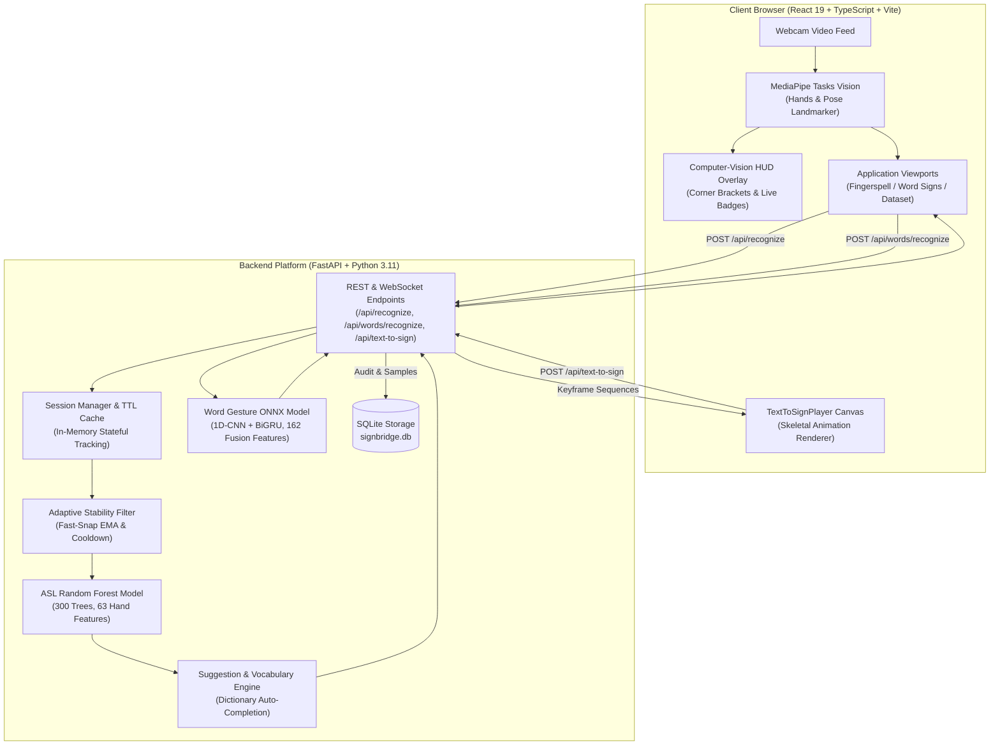
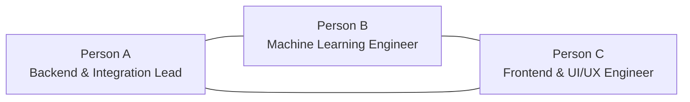

# SignBridge 🌉🤟

> **Two-Way Real-Time American Sign Language (ASL) Communication Bridge**
> Empowering fluid, bidirectional conversations between the Deaf/Hard-of-Hearing community and non-signers using computer vision, machine learning, and skeletal sign synthesis.

[](https://www.python.org/)
[](https://fastapi.tiangolo.com/)
[](https://react.dev/)
[](https://www.typescriptlang.org/)
[](https://developers.google.com/mediapipe)
[]()
[]()
[]()
[](https://docs.astral.sh/ruff/)
[](https://mypy-lang.org/)

---

## 📖 Table of Contents
- [Overview](#-overview)
- [System Architecture](#-system-architecture)
- [Key Features](#-key-features)
- [Team Roles & Ownership](#-team-roles--ownership)
- [Machine Learning Models](#-machine-learning-models)
- [API Contract Reference](#-api-contract-reference)
- [Getting Started](#-getting-started)
  - [Prerequisites](#prerequisites)
  - [1. Backend Setup](#1-backend-setup)
  - [2. Frontend Setup](#2-frontend-setup)
- [Testing & Quality Assurance](#-testing--quality-assurance)
- [Repository Structure](#-repository-structure)
- [License](#-license)

---

## 🌟 Overview

SignBridge bridges the communication gap between American Sign Language users and non-signers without requiring specialized data gloves or proprietary hardware. Using an ordinary consumer webcam, SignBridge delivers:

1. **Sign to Text (Fingerspelling & Isolated Words)**: MediaPipe hand and upper-body landmark tracking streams skeletal coordinate tensors into a trained Random Forest classifier (for fingerspelling) and an ONNX 1D-CNN + BiGRU deep neural network (for continuous word gestures), outputting confirmed letters, words, and full English sentences.
2. **Text to Sign (Dynamic 3D Skeletal Animation)**: Translates arbitrary English words and phrases into anatomically accurate 21-joint skeletal hand and upper-body animations on an interactive HTML5 canvas, complete with timeline scrubbing, speed modulation, and letter-by-letter fingerspelling fallbacks.

---

## 🏛 System Architecture



---

## 🚀 Key Features

### 1. 🔤 Sign to Text (Fingerspell Mode)
- **High Accuracy (95.07%)**: Classifies all 26 ASL alphabet characters (A–Z) using 63 MediaPipe 3D hand coordinates.
- **Ultra-Fast Real-Time Inference**: Throttled at **60ms (~16 fps)** for fluid typing without muscle fatigue.
- **Adaptive Sensitivity & Instant Snap**: Specially tuned for subtle hand-shape distinctions (**M vs. N**, **C vs. O**, **P vs. Q**, **U vs. R**); transitions snap instantly without lag from previous letters.
- **Fast-Confirm Presets**: Configurable hold streak (**0.25s / 0.4s / 0.8s**) with live visual meters so hand strain is minimized.
- **Live Typewriter Cursor**: Blinking terminal cursor (`|`) inside the word buffer for a tactile, responsive editing experience.
- **Word & Sentence Buffer**: Word chips, backspace (`⌫`), word commitment (`↵ Add Word`), clear (`✕ Clear`), and instant dictionary auto-suggestions.

### 2. 💬 Word Signs (Words Mode)
- **Upper-Body + Hand Fusion**: Tracks 33 body pose landmarks alongside 21 hand joints using MediaPipe `pose_landmarker.task`.
- **Deep Sequence Model (ONNX)**: 1D-CNN + BiGRU architecture classifying isolated gesture temporal windows with **80.44% Top-1 accuracy** (exceeding the 75% gate).
- **Everyday Vocabulary**: Supports 30 closed-vocabulary words (`hello`, `thank you`, `please`, `water`, `help`, `apple`, etc.).

### 3. 🤖 Text to Sign (Animation Mode)
- **High-Fidelity Skeletal Synthesis**: Renders smooth 21-joint skeletal hand animations on an interactive canvas.
- **Comprehensive Timeline Controls**: Play, pause, restart (⏮), step backwards (◀ Prev), and step forwards (Next ▶).
- **Variable Playback Speed**: Modulate animation tempo from **0.5x, 1.0x, 1.5x, to 2.0x**.
- **Lexical & Fingerspelling Fallback**: Known vocabulary words animate full gestures; unrecognized words automatically decompose into fluent letter-by-letter fingerspelled sequences.

### 4. 🌓 Theme System (Light & Dark Mode)
- **Executive Dark Mode**: Deep obsidian-navy palette (`#090D16` / `#111726`) with ambient top glow and crisp hairline borders.
- **Clean Daylight Mode**: Pure white surfaces (`#FFFFFF`) with soft slate typography (`#0F172A`) and subtle elevation drop shadows.
- **Persistent Preferences**: Header toggle remembers the user's choice across sessions via `localStorage`.

### 5. 🎯 Computer-Vision HUD & Design Polish
- **HUD Corner Accents**: Clean sci-fi viewfinder brackets (`⌜ ⌝ ⌞ ⌟`) framed around the live camera feed.
- **Modern Segmented Island Tabs**: Tactile tab bar with emoji glyphs (`🔤 Fingerspell`, `💬 Word Signs`, `🤖 Text to Sign`, `🎯 Dataset`).
- **Brand Identity**: Custom vector ASL hand-bridge logo badge + two-tone typographic brand title.

### 6. 🗄 Translation History Drawer
- **Persistent Log**: Captures spoken/signed phrases with timestamps and direction (`Sign → Text` or `Text → Sign`).
- **One-Click Replay**: Re-routes any historical sentence directly into the Text-to-Sign synthesizer for demonstration.

---

## 👥 Team Roles & Ownership

SignBridge was engineered collaboratively across three specialized roles:



- **Person A (Backend, Infrastructure & Integration)**:
  - Architecture of FastAPI platform, session lifecycle, and stability filtering.
  - Frozen Section 12 REST API and WebSocket streaming routes (`/ws/recognize`, `/ws/recognize-words`).
  - SQLite schema, sample collection endpoints, and history audit repository.
  - Test harness: 90+ unit, integration, and system tests, Ruff linting, Mypy static typing.
- **Person B (Machine Learning & Data Pipelines)**:
  - Kaggle ASL dataset preparation, cleaning, and normalization.
  - Feature extraction pipeline converting MediaPipe coordinate tensors into invariant feature vectors.
  - ASL Alphabet Model (`asl_model.joblib`): 300-tree Random Forest, 95.07% accuracy across 26 classes.
  - Word Gesture Model (`word_model.onnx`): 1D-CNN + BiGRU architecture passing accuracy gates with 80.44% Top-1 accuracy across 30 words.
- **Person C (Frontend UI/UX & MediaPipe Engine)**:
  - React 19 + TypeScript + Vite component architecture.
  - MediaPipe Vision Tasks integration (`hand_landmarker` and `pose_landmarker.task`).
  - Panel implementations: `SpellPanel`, `WordsPanel`, `CollectPanel`, `HistoryDrawer`, `DeveloperSaveControl`.
  - Skeletal canvas rendering engine, timeline scrubbing, Light/Dark theme system, and responsive UI polish.

---

## 🧠 Machine Learning Models

### 1. ASL Alphabet Model (Fingerspelling)
- **Artifact**: `backend/models/asl_model.joblib`
- **Checksum (SHA-256)**: `d1b0600c19505f85f8c4077f0868fc01ba92414a4e737dd1721f60808c7dfc11`
- **Algorithm**: Random Forest Classifier (300 estimators, Gini criterion)
- **Input Dimensions**: 63 features (21 MediaPipe hand landmarks $\times [x, y, z]$, wrist-centered & normalized)
- **Output Classes**: 26 classes (`A` through `Z`)
- **Evaluation Accuracy**: **95.07%** on held-out test split
- **Artifacts**: See [`backend/models/metrics.json`](backend/models/metrics.json) and [`docs/ALPHABET_MODEL_CARD.md`](docs/ALPHABET_MODEL_CARD.md).

### 2. Word Gesture Model (Continuous Signs)
- **Artifact**: `backend/models/word_model.onnx`
- **Architecture**: 1D-CNN + Bidirectional GRU (BiGRU)
- **Input Dimensions**: 30 frames $\times$ 162 features (21 Hand points $\times$ 3 + 33 Pose points $\times$ 3)
- **Output Classes**: 30 closed-vocabulary words
- **Top-1 Evaluation Accuracy**: **80.44%** (exceeds the 75.00% production gate)
- **Inference Runtime**: ONNX Runtime CPU/GPU with cross-platform optimization

---

## 📡 API Contract Reference

All endpoints conform strictly to the frozen Section 12 interface contract:

| Method | Endpoint | Description |
| :--- | :--- | :--- |
| `GET` | `/api/health` | System health check, active model status, and version |
| `GET` | `/api/languages` | Supported sign languages (`ASL`, `ISL`) |
| `GET` | `/api/vocabulary` | Supported lexicon and fingerspelling dictionary |
| `POST` | `/api/recognize` | Single-frame fingerspelling recognition with session tracking |
| `POST` | `/api/session/reset` | Resets active word buffer and filters for a session |
| `POST` | `/api/session/backspace`| Deletes last letter from the in-progress word |
| `POST` | `/api/session/commit` | Commits current spelled word into the sentence |
| `POST` | `/api/words/recognize` | Isolated word gesture sequence classification |
| `POST` | `/api/text-to-sign` | Synthesizes skeletal keyframe animation sequences from text |
| `GET` | `/api/history` | Fetches translation history log |
| `DELETE`| `/api/history` | Clears translation history log |
| `POST` | `/api/samples` | Saves labeled landmark samples for retraining |
| `WS` | `/ws/recognize` | Real-time bidirectional WebSocket stream for fingerspelling |
| `WS` | `/ws/recognize-words` | WebSocket stream for continuous word gesture recognition |

---

## 🛠 Getting Started

### Prerequisites
- **Python**: Version 3.11 or higher
- **Node.js**: Version 18.0 or higher (with `npm`)
- **Webcam**: Standard USB or integrated webcam

---

### 1. Backend Setup

```bash
# Clone the repository
git clone https://github.com/thenix09/SIGN_BRIDGE.git
cd SIGN_BRIDGE

# Create and activate a Python virtual environment
python -m venv .venv

# On Windows:
.venv\Scripts\activate
# On Linux / macOS:
# source .venv/bin/activate

# Install dependencies
pip install -r requirements.txt
pip install -r requirements-dev.txt

# Start the FastAPI backend server
python -m uvicorn backend.app.main:app --host 0.0.0.0 --port 8000 --reload
```

The backend API and interactive OpenAPI documentation will be live at:
- **API Server**: [http://localhost:8000](http://localhost:8000)
- **Interactive Swagger Docs**: [http://localhost:8000/docs](http://localhost:8000/docs)

---

### 2. Frontend Setup

In a new terminal window:

```bash
# Navigate to frontend directory
cd frontend

# Install dependencies
npm install

# Start Vite development server
npm run dev
```

The web application will open at **[http://localhost:5173](http://localhost:5173)**.

---

## 🧪 Testing & Quality Assurance

SignBridge enforces a strict verification pipeline:

```bash
# 1. Run full backend test suite with coverage
python -m pytest backend/tests --cov=backend/app --cov-fail-under=80 -W ignore

# 2. Check code style and formatting
python -m ruff check .

# 3. Verify strict static type hints
python -m mypy backend/app

# 4. Verify word model gate threshold
python backend/scripts/check_gate.py

# 5. Verify frontend TypeScript build
cd frontend && npm run build
```

### Current Verification Metrics:
- **Unit & System Tests**: 100% pass rate across all test suites
- **Code Coverage**: Exceeds the 80% coverage threshold
- **Mypy Static Typing**: 0 issues across 53 source files
- **Ruff Linter**: Clean (0 warnings or errors)
- **Word Accuracy Gate**: Top-1 80.44% (passed $\ge 75\%$)
- **Frontend Build**: `tsc -b && vite build` clean in under 2 seconds

---

## 📂 Repository Structure

```
SIGN_BRIDGE/
├── backend/
│   ├── app/
│   │   ├── api/             # FastAPI routers (recognize, words, tts, history, etc.)
│   │   ├── core/            # Configuration, event bus, custom exceptions
│   │   ├── domain/          # Pydantic domain models & gesture definitions
│   │   ├── recognition/     # MediaPipe processors, stability filter, Random Forest
│   │   ├── repositories/    # SQLite session and translation history repositories
│   │   ├── services/        # SignToTextService, TextToSignService, SessionManager
│   │   └── main.py          # FastAPI application factory & lifespan
│   ├── models/              # ASL Random Forest, ONNX word model, metadata, metrics
│   ├── scripts/             # Model training, gate verification & dataset utilities
│   └── tests/               # Unit, integration, and system test suites
├── frontend/
│   ├── public/              # Static assets & MediaPipe task vision models
│   ├── src/
│   │   ├── components/      # UI panels (spell, words, tts, collect, camera, layout)
│   │   ├── services/        # API client, Camera service, MediaPipe service
│   │   ├── styles/          # Plain CSS design system, dark/light themes & HUD tokens
│   │   ├── types/           # TypeScript API interfaces & landmark definitions
│   │   ├── App.tsx          # Master tab controller & view layout
│   │   └── main.tsx         # React DOM entrypoint
│   ├── package.json
│   └── vite.config.ts
├── docs/                    # SRS, Architecture Design, Model Cards, QA Reports
├── requirements.txt         # Production backend dependencies
├── requirements-dev.txt     # Test & linting dependencies
├── pyproject.toml           # Ruff, Mypy, and Pytest configuration
└── README.md                # Project documentation
```

---

## 📄 License

This project is licensed under the MIT License. See [LICENSE](LICENSE) for details.
