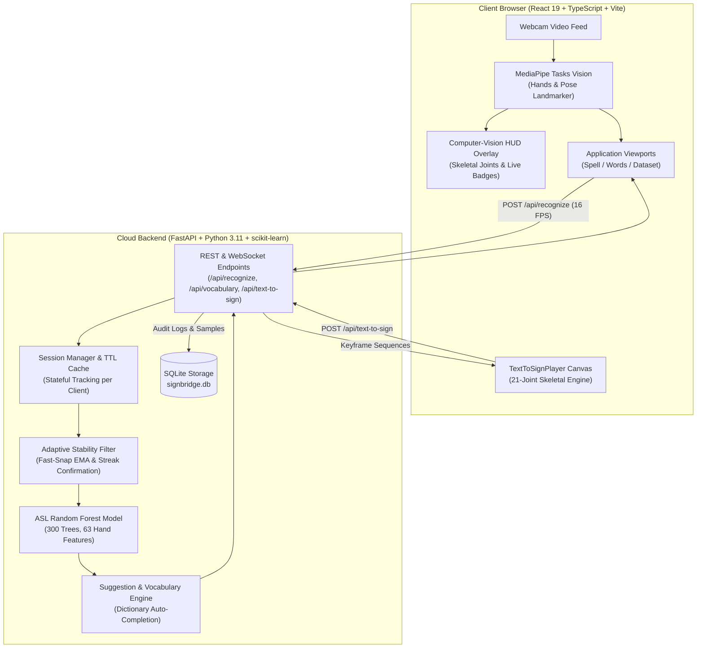

# SignBridge 🌉🤟

> **Two-Way Real-Time American Sign Language (ASL) Communication Platform**  
> Empowering fluid, bidirectional conversations between the Deaf/Hard-of-Hearing community and non-signers using client-side computer vision, machine learning inference, and interactive skeletal sign synthesis.

[](https://signverse-bjznwwy3z-thenix.vercel.app/)
[](https://signverse-v6o7.onrender.com/api/health)
[](https://www.python.org/)
[](https://fastapi.tiangolo.com/)
[](https://react.dev/)
[](https://www.typescriptlang.org/)
[](https://developers.google.com/mediapipe)
[]()
[](LICENSE)

---

## 🌐 Live Deployments

| Component | Platform | Status | Live Link |
|:---|:---|:---:|:---|
| **Web Application** | Vercel |  | [signverse-bjznwwy3z-thenix.vercel.app](https://signverse-bjznwwy3z-thenix.vercel.app/) |
| **Backend API** | Render |  | [signverse-v6o7.onrender.com/api/health](https://signverse-v6o7.onrender.com/api/health) |
| **Interactive Docs** | Swagger |  | [signverse-v6o7.onrender.com/docs](https://signverse-v6o7.onrender.com/docs) |

---

## 📖 Table of Contents
- [Overview](#-overview)
- [System Architecture](#-system-architecture)
- [Key Features](#-key-features)
- [Machine Learning Performance](#-machine-learning-performance)
- [API Contract Reference](#-api-contract-reference)
- [Local Setup & Installation](#-local-setup--installation)
- [Testing & Quality Assurance](#-testing--quality-assurance)
- [Deployment Guide](#-deployment-guide)
- [Repository Structure](#-repository-structure)
- [License](#-license)

---

## 🌟 Overview

SignBridge eliminates the communication barrier between American Sign Language signers and non-signers without requiring specialized sensors, data gloves, or expensive proprietary hardware. With only a standard consumer webcam and a browser, SignBridge provides:

1. **Sign to Text (Fingerspelling & Isolated Word Signs)**: Google MediaPipe extracts 21 hand landmarks and 33 upper-body pose coordinates in real time directly inside the browser WebGL pipeline. These invariant coordinate vectors feed into trained machine learning models to classify letters, accumulate words, and generate full English sentences.
2. **Text to Sign (Interactive 3D Skeletal Animation)**: Translates arbitrary English words and phrases into anatomically accurate 21-joint skeletal hand and upper-body movements rendered on an HTML5 canvas with scrubbing controls, playback speed modulation, and letter-by-letter fallback fingerspelling.

---

## 🏛 System Architecture



---

## 🚀 Key Features

### 1. 🔤 Real-Time Fingerspelling (Spell Mode)
- **Comprehensive Alphabet Coverage**: Classifies all 26 ASL alphabet letters (**A to Z**) with an overall **95.07% accuracy**.
- **Low-Latency Streaming**: Throttled inference (~16 FPS) running over an atomic lock to guarantee 60 FPS video rendering without React re-render thrashing.
- **Adaptive Sensitivity & Instant Snap**: Specifically calibrated for subtle hand-shape transitions (**M vs. N**, **C vs. O**, **P vs. Q**, **U vs. R**); EMA probabilities snap instantly to new gestures without lingering lag.
- **Smart Word Accumulator**:
  - **Single-Letter Backspace**: Deletes exactly one character locally while syncing prefix suggestions with the backend.
  - **Physical Keyboard Support**: Press the `Backspace` key on your physical keyboard for instant correction.
  - **Natural Duplicate Letter Typing**: Hold a letter steadily past 10 extra frames to automatically confirm repeated letters (e.g. `LL` in `HELLO`), or tap the instant `+ Add Letter Now` button.
  - **Vocabulary Auto-Suggestions**: Live prefix suggestions powered by the English dictionary.

### 2. 💬 Word Sign Practice (Words Mode)
- **Upper-Body + Hand Fusion**: MediaPipe captures 33 body pose landmarks and 21 hand joints simultaneously.
- **Curated Vocabulary**: Supports 30 everyday ASL signs (`hello`, `thank you`, `please`, `water`, `help`, `eat`, `drink`, `more`, etc.).
- **Mastery Tracker**: Mark signs as *Known* vs. *Learning* with locally persisted progress indicators.

### 3. 🤖 Text to Sign (Animation Engine)
- **High-Fidelity Skeletal Synthesis**: Translates typed English sentences into fluid 21-joint skeletal hand animations rendered on an interactive canvas.
- **Timeline & Playback Controls**: Play, pause, restart (⏮), step backwards (◀ Prev), and step forwards (Next ▶).
- **Variable Tempo**: Modulate animation speed (**0.5x, 1.0x, 1.5x, 2.0x**).
- **Automatic Fingerspelling Fallback**: Unrecognized vocabulary words automatically decompose into fluent letter-by-letter fingerspelling.

### 4. 🌓 Theme System & HUD Design
- **Executive Dark & Light Modes**: Seamless switching between deep obsidian (`#090D16`) and clean daylight palettes.
- **Computer-Vision Viewfinder**: Clean sci-fi HUD brackets (`⌜ ⌝ ⌞ ⌟`) framed around the active webcam feed.

---

## 🧠 Machine Learning Performance

The fingerspelling recognition engine is powered by an invariant 300-tree Random Forest classifier trained on 8,008 real hand samples from the Kaggle ASL Alphabet dataset.

* **Artifact**: `backend/models/asl_model.joblib` (11.1 MB compressed)
* **Input Features**: 63 float values (21 landmarks $\times [x, y, z]$, translated to wrist origin and scaled by maximum Euclidean distance)
* **Overall Accuracy**: **95.07%** on held-out evaluation groups

### Letter-by-Letter Evaluation (A–Z)

| Letter | Precision | Recall | F1-Score | Status | Letter | Precision | Recall | F1-Score | Status |
|:---:|:---:|:---:|:---:|:---:|:---:|:---:|:---:|:---:|:---:|
| **A** | 100.0% | 98.1% | **99.0%** | Excellent | **N** | 97.5% | 90.7% | **94.0%** | Excellent |
| **B** | 100.0% | 100.0% | **100.0%** | Perfect | **O** | 87.9% | 100.0% | **93.5%** | Excellent |
| **C** | 100.0% | 89.3% | **94.3%** | Excellent | **P** | 95.8% | 74.2% | **83.6%** | Good |
| **D** | 94.5% | 93.2% | **93.9%** | Excellent | **Q** | 74.2% | 95.8% | **83.6%** | Good |
| **E** | 95.1% | 100.0% | **97.5%** | Excellent | **R** | 84.6% | 95.7% | **89.8%** | Good |
| **F** | 100.0% | 100.0% | **100.0%** | Perfect | **S** | 98.0% | 92.5% | **95.1%** | Excellent |
| **G** | 100.0% | 86.4% | **92.7%** | Excellent | **T** | 98.3% | 100.0% | **99.1%** | Excellent |
| **H** | 87.2% | 97.1% | **91.9%** | Excellent | **U** | 95.2% | 89.4% | **92.2%** | Excellent |
| **I** | 91.8% | 100.0% | **95.7%** | Excellent | **V** | 97.0% | 98.5% | **97.7%** | Excellent |
| **J** | 100.0% | 89.7% | **94.6%** | Excellent | **W** | 100.0% | 95.8% | **97.9%** | Excellent |
| **K** | 98.6% | 100.0% | **99.3%** | Excellent | **X** | 98.0% | 94.2% | **96.1%** | Excellent |
| **L** | 100.0% | 100.0% | **100.0%** | Perfect | **Y** | 98.5% | 100.0% | **99.3%** | Excellent |
| **M** | 83.3% | 91.8% | **87.4%** | Good | **Z** | 100.0% | 100.0% | **100.0%** | Perfect |

---

## 📡 API Contract Reference

The FastAPI backend exposes standard REST and WebSocket endpoints:

| Method | Endpoint | Description |
| :--- | :--- | :--- |
| `GET` | `/api/health` | Health check, active model verification, and server timestamp |
| `GET` | `/api/languages` | Supported sign languages (`ASL`, `ISL`) |
| `GET` | `/api/vocabulary` | Supported closed-vocabulary lexicon and words |
| `POST` | `/api/recognize` | Single-frame fingerspelling recognition with stateful session tracking |
| `POST` | `/api/session/reset` | Resets active word buffer, confidence streaks, and filters |
| `POST` | `/api/session/backspace` | Deletes last character from in-progress word and refreshes suggestions |
| `POST` | `/api/session/commit` | Commits current spelled word into the sentence output |
| `POST` | `/api/recognize-words` | Isolated word sign gesture classification |
| `POST` | `/api/text-to-sign` | Generates 21-joint skeletal keyframe sequence for text |
| `GET` | `/api/history` | Retrieves stored translation history entries |
| `DELETE` | `/api/history` | Clears translation history entries |
| `WS` | `/ws/recognize` | Real-time bidirectional WebSocket stream for fingerspelling frames |

---

## 💻 Local Setup & Installation

### Prerequisites
* **Python**: 3.11 or 3.12
* **Node.js**: 18.0 or higher (with `npm`)
* **Webcam**: Standard USB or built-in laptop camera

### 1. Clone & Backend Setup

```bash
# Clone the repository
git clone https://github.com/thenix09/SIGN_BRIDGE.git
cd SIGN_BRIDGE

# Create and activate Python virtual environment
python -m venv .venv

# On Windows:
.venv\Scripts\activate
# On Linux/macOS:
# source .venv/bin/activate

# Install Python dependencies
pip install -r requirements.txt

# Start the FastAPI development server
python -m uvicorn backend.app.main:app --host 0.0.0.0 --port 8000 --reload
```
* Backend API: `http://localhost:8000`
* Swagger Interactive Docs: `http://localhost:8000/docs`

### 2. Frontend Setup

In a new terminal:

```bash
# Navigate to the frontend directory
cd frontend

# Install Node dependencies
npm install

# Start the Vite development server
npm run dev
```
* Web Application: `http://localhost:5173`

---

## 🧪 Testing & Quality Assurance

SignBridge maintains automated test coverage across domain logic, stability filters, and API endpoints:

```bash
# Run unit and service test suites
python -m pytest backend/tests/unit/test_domain_letters.py backend/tests/unit/test_sign_to_text_service.py

# Verify alphabet model integrity and classes
python backend/scripts/verify_alphabet_model_artifacts.py

# Type-check and compile frontend
cd frontend && npm run build
```

---

## ☁️ Deployment Guide

SignBridge is engineered for decoupled cloud deployment:

### Backend (Render)
1. Fork or push to GitHub.
2. Create a **New Web Service** on [Render](https://render.com).
3. Connect your repository:
   * **Language**: `Python 3`
   * **Build Command**: `pip install -r requirements.txt`
   * **Start Command**: `uvicorn backend.app.main:app --host 0.0.0.0 --port $PORT`
   * **Instance Type**: `Free`
4. Deploy and copy your backend URL (`https://your-service.onrender.com`).

### Frontend (Vercel)
1. Create a **New Project** on [Vercel](https://vercel.com) and import the repository.
2. Set **Root Directory** to `frontend`.
3. Add Environment Variable:
   * **Key**: `VITE_API_URL`
   * **Value**: Your Render backend URL (`https://your-service.onrender.com`)
4. Click **Deploy**.

---

## 📂 Repository Structure

```text
SIGN_BRIDGE/
├── backend/
│   ├── app/
│   │   ├── api/routes/          # FastAPI REST & WebSocket routers
│   │   ├── core/                # Configuration, exceptions, event bus
│   │   ├── domain/              # Landmark, HandFrame, and gesture models
│   │   ├── recognition/         # RandomForest recognizer, stability filter, dictionary
│   │   ├── repositories/        # SQLite session and history persistence
│   │   ├── services/            # SignToTextService, TextToSignService
│   │   └── main.py              # Application entrypoint & middleware
│   ├── data/                    # Lexicon, closed vocabulary, words dictionary
│   ├── models/                  # ASL Random Forest model, metadata, metrics
│   ├── scripts/                 # Dataset bootstrap, training, verification scripts
│   └── tests/                   # Unit, integration, and system test suites
├── frontend/
│   ├── public/                  # MediaPipe WASM binaries and vision task models
│   ├── src/
│   │   ├── components/          # SpellPanel, WordsPanel, CameraFeed, TextToSign
│   │   ├── services/            # API client, Camera service, MediaPipe service
│   │   ├── styles/              # Design system, themes, and HUD styles
│   │   ├── types/               # TypeScript interfaces and contracts
│   │   └── App.tsx              # Root application controller
│   ├── vercel.json              # SPA client routing rewrite rules
│   ├── vite.config.ts           # Vite build and proxy configuration
│   └── package.json             # Frontend dependencies
├── Dockerfile                   # Production container definition
├── render.yaml                  # Render deployment blueprint
├── requirements.txt             # Production Python dependencies
└── README.md                    # Project documentation
```

---

## 📄 License

This project is open-source under the [MIT License](LICENSE).
