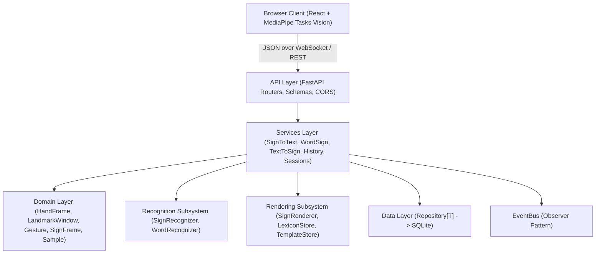
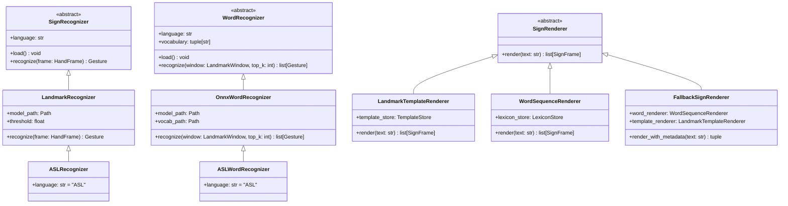
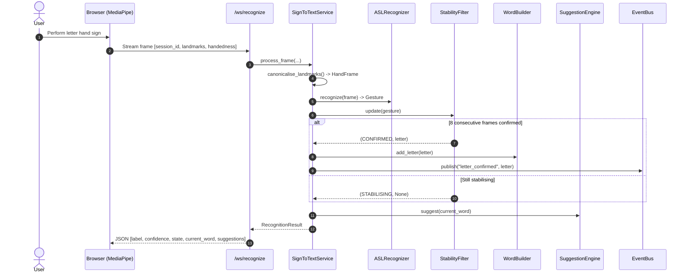
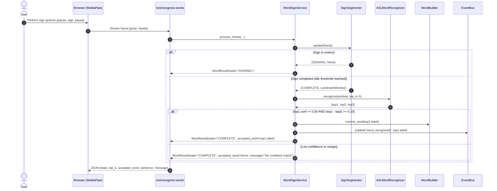
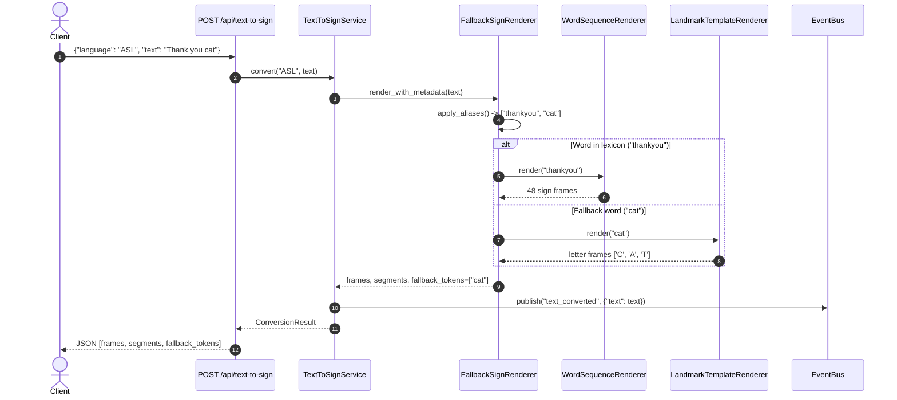
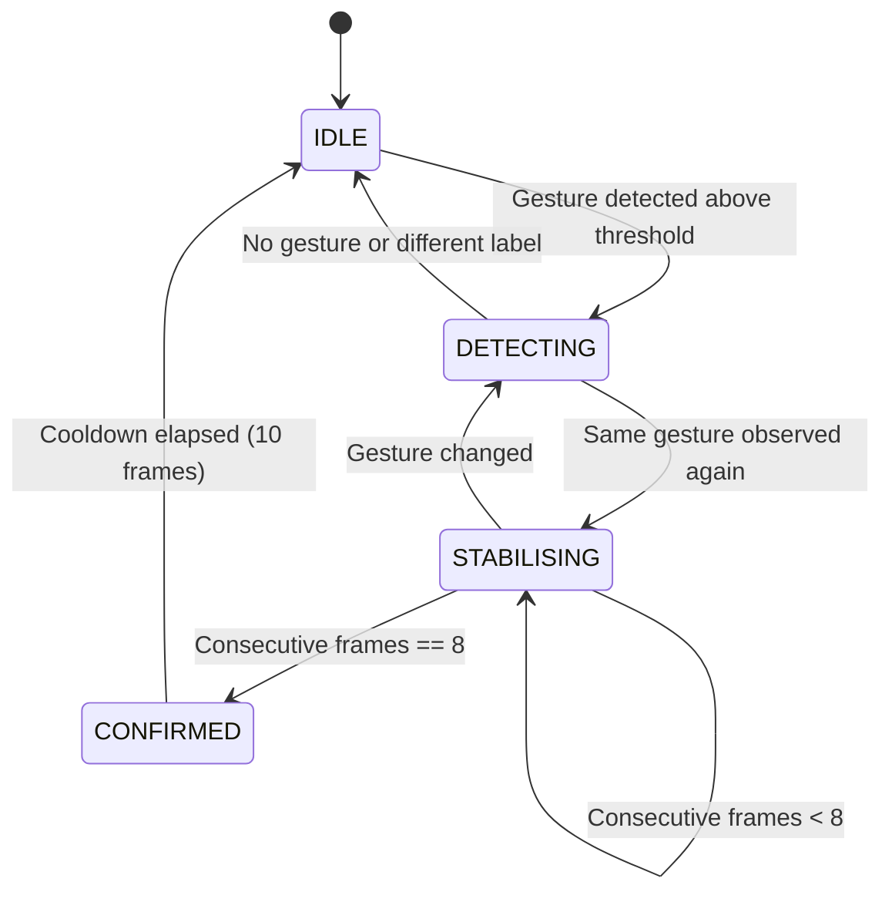
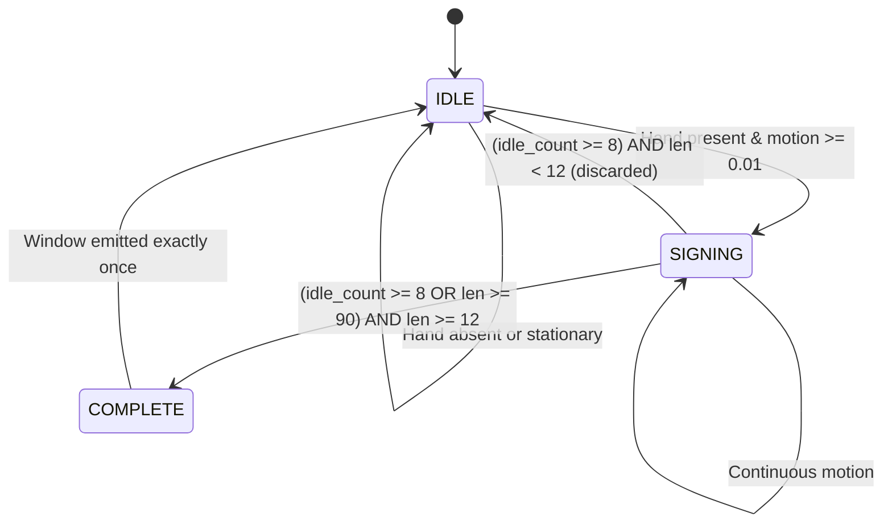

# SignBridge System Architecture & Design Document

This document defines the high-level architecture, design decisions, software patterns, sequence workflows, and state machines implemented in **SignBridge**.

---

## 1. System Architecture

SignBridge uses a strictly layered architecture with unidirectional dependency flow:
$$\text{Presentation (API / WebSocket)} \longrightarrow \text{Service Layer} \longrightarrow \text{Domain / Strategies} \longrightarrow \text{Repositories / Persistence}$$

---

## 2. Design Decisions & Trade-offs

| Decision | Alternatives Considered | Reason for Choice | Trade-off |
| :--- | :--- | :--- | :--- |
| **Client-side MediaPipe** | Server-side video streaming / OpenCV | Zero video transmission, privacy by design, reduced server bandwidth and compute | Client device GPU/CPU load |
| **RandomForest for Letters** | 2D CNN / MobileNet on cropped images | Deterministic landmark vector input (63 floats), fast CPU inference (<10 ms), small footprint | Cannot easily model raw pixel features |
| **SQLite with SQLAlchemy** | PostgreSQL / MongoDB | Zero-config standalone deployment, single-worker execution, portable | Concurrency limited to single process / file locks |
| **1D CNN + BiGRU for Words** | Transformer / Heavy 3D CNN | Sequence of 32 frames with 104 features runs efficiently in ONNX runtime | Moderate vocabulary capacity (30–50 words) |
| **Closed Vocabulary (30 words)**| Open vocabulary translation | High accuracy on isolated sign recognition within 7-day timeline | Not continuous sentence translation |
| **Nearest-Wrist Slot Assignment** | Handedness label classification | Immune to camera mirror confusion and user handedness flips | Needs clear pose tracking |
| **Dominant-Hand Canonicalisation** | Separate models for L/R hands | Doubles effective training data and simplifies single model | Requires dominant hand detection |
| **No Face Mesh (Pose only)** | 468-point Face Mesh | Avoids heavy compute; 3 key points (nose, mouth corners) capture facial relative height | Lacks fine facial expression grammar |
| **Single Handedness Rule (Letters)** | Automatic mirroring heuristic | Consistent server-side canonicalisation using majority dataset label | Requires client to send MediaPipe label |

---

## 3. Design Patterns Applied

| Pattern | Location | Purpose |
| :--- | :--- | :--- |
| **Abstraction** | `SignRecognizer`, `WordRecognizer`, `SignRenderer`, `Repository[T]` | Decouples high-level service logic from specific model frameworks or storage backends. |
| **Inheritance** | `LandmarkRecognizer` $\to$ `ASLRecognizer`, `ISLRecognizer`; `OnnxWordRecognizer` $\to$ `ASLWordRecognizer` | Extends base normalization and inference routines for language-specific specializations. |
| **Polymorphism** | `FakeRecognizer`, `FakeWordRecognizer`, `FakeSignRenderer` | Allows instant substitution of fakes in unit and integration test suites without disk dependencies. |
| **Encapsulation** | `HandFrame`, `LandmarkWindow`, `StabilityFilter`, `SignSegmenter`, `WordBuilder` | Domain objects enforce strict coordinate validations and immutable post-initialization state. |
| **Strategy & Factory** | `RecognizerFactory`, `RendererFactory` | Dynamically instantiates the appropriate recognition or rendering algorithm based on mode and language code. |
| **Composite** | `FallbackSignRenderer` | Combines `WordSequenceRenderer` and `LandmarkTemplateRenderer` into a unified playback pipeline. |
| **Observer** | `EventBus` | Decouples recognition services from audit persistence in `HistoryService`. |
| **Singleton** | `Settings` via `get_settings()` with `@lru_cache` | Centralized, environment-overridable configuration singleton. |
| **Repository** | `SQLiteTranslationRepository`, `SQLiteSampleRepository` | Encapsulates database queries behind `Repository[T]` abstraction. |
| **State** | `StabilityFilter` (`RecognizerState`), `SignSegmenter` (`SegmenterState`) | Stateful lifecycle transitions for multi-frame letter confirmation and gesture boundary detection. |
| **Dependency Injection** | `backend/app/api/deps.py` | FastAPI `Depends()` injects singletons and services into route handlers. |

---

## 4. Class Architecture

---

## 5. Sequence Workflows

### 5.1 Sign-to-Text (Fingerspelling Pipeline)

### 5.2 Word Recognition Sequence Workflow

### 5.3 Text-to-Sign Sequence Workflow

---

## 6. State Machine Diagrams

### 6.1 StabilityFilter State Lifecycle

### 6.2 SignSegmenter State Lifecycle

---

## 7. API Changelog

| Date | Author | Version | Notes / Changes |
| :--- | :--- | :--- | :--- |
| **2026-11-07** | Person A | 1.0.0 | Frozen API contract established (Section 12). Scaffold and sample response fixtures committed. |
| **2026-11-09** | Person A | 1.1.0 | Added real-time fingerspelling endpoints (`POST /api/recognize`, `WS /ws/recognize`, `POST /api/session/*`, `GET /api/languages`). |
| **2026-11-09** | Person A | 1.2.0 | Implemented isolated word recognition endpoints (`POST /api/recognize-words`, `WS /ws/recognize-words`, `GET /api/vocabulary`). |
| **2026-11-09** | Person A | 1.3.0 | Implemented text-to-sign rendering endpoint (`POST /api/text-to-sign`). |
| **2026-11-09** | Person A | 1.4.0 | Added audit history endpoints (`GET /api/history`, `DELETE /api/history`) and training sample collection (`POST /api/samples`, `GET /api/samples/stats`, `GET /api/samples/export`). |
