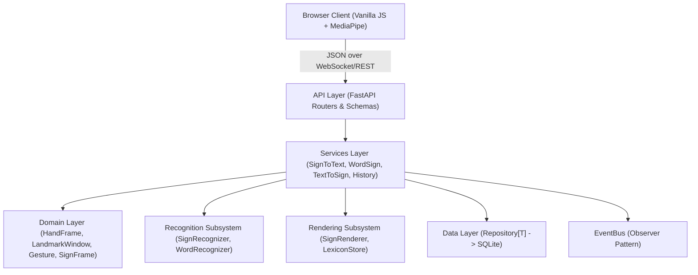

# SignBridge Design Document

## 1. System Architecture

SignBridge uses a layered architecture with strict unidirectional flow:
`Presentation (API/WebSocket) -> Services -> Domain & Recognition/Rendering Strategies -> Persistence/Repositories`.

## 2. Design Decisions & Trade-offs

| Decision | Alternatives Considered | Reason for Choice | Trade-off |
| :--- | :--- | :--- | :--- |
| **Client-side MediaPipe** | Server-side video streaming / OpenCV | Zero video transmission, privacy by design, reduced server bandwidth and compute | Client device GPU/CPU load |
| **RandomForest for Letters** | 2D CNN / MobileNet on cropped images | Deterministic landmark vector input (63 floats), fast CPU inference (<10ms), small footprint | Cannot easily model raw pixel features |
| **SQLite with SQLAlchemy** | PostgreSQL / MongoDB | Zero-config standalone deployment, single-worker execution, portable | Concurrency limited to single process / file locks |
| **1D CNN + BiGRU for Words** | Transformer / Heavy 3D CNN | Sequence of 32 frames with 104 features runs efficiently in ONNX runtime | Moderate vocabulary capacity (30-50 words) |
| **Closed Vocabulary (30 words)**| Open vocabulary translation | High accuracy on isolated sign recognition within 7-day timeline | Not continuous sentence translation |
| **Nearest-Wrist Slot Assignment** | Handedness label classification | Immune to camera mirror confusion and user handedness flips | Needs clear pose tracking |
| **Dominant-Hand Canonicalisation** | Separate models for L/R hands | Doubles effective training data and simplifies single model | Requires dominant hand detection |
| **No Face Mesh (Pose only)** | 468-point Face Mesh | Avoids heavy compute; 3 key points (nose, mouth corners) capture facial relative height | Lacks fine facial expression grammar |
| **Single Handedness Rule (Letters)** | Automatic mirroring heuristic | Consistent server-side canonicalisation using majority dataset label | Requires client to send MediaPipe label |

## 3. Design Patterns Applied

- **Abstraction & Polymorphism**: `SignRecognizer`, `WordRecognizer`, `SignRenderer`, `Repository[T]`.
- **Strategy & Factory**: `RecognizerFactory` and `RendererFactory` instantiate appropriate algorithm implementations.
- **State Pattern**: `StabilityFilter` with `RecognizerState` (IDLE, DETECTING, STABILISING, CONFIRMED); `SignSegmenter` with `SegmenterState` (IDLE, SIGNING, COMPLETE).
- **Observer Pattern**: `EventBus` decouples services from audit logging in `HistoryService`.
- **Composite Pattern**: `FallbackSignRenderer` composes `WordSequenceRenderer` and `LandmarkTemplateRenderer`.
- **Singleton Pattern**: Cached application `Settings` via `get_settings()`.

## 4. API Changelog

| Date | Author | Version | Notes / Changes |
| :--- | :--- | :--- | :--- |
| 2026-11-07 | Person A | 1.0.0 | Frozen API contract established (Section 12). Sample responses committed. |
